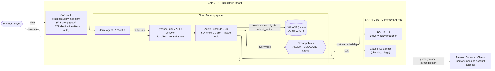
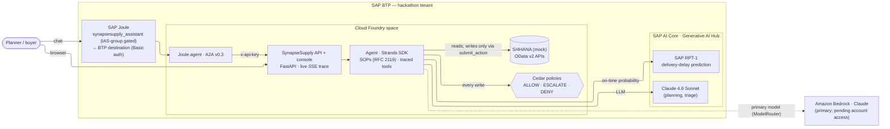
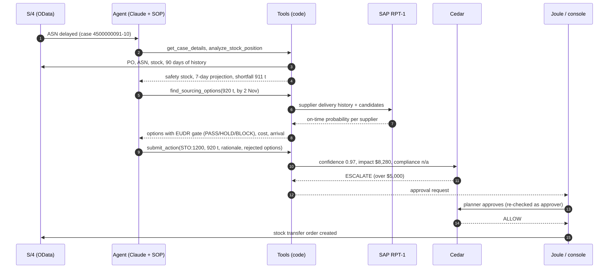
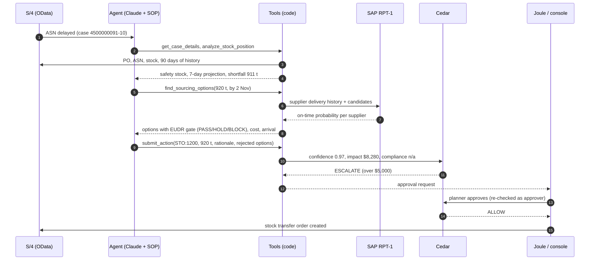

# Architecture (as built, 2026-10-22)

Everything below runs today. Items marked *planned* are designed but not deployed (see "Not yet
built" at the end).

## System

## One case

## Who decides what

| Decision | Made by |
|---|---|
| Stock projection, safety stock, shortfall | Code (`domain/inventory.py`, `domain/supply.py`) |
| Which options exist; their arrival, cost, compliance | Code (`domain/options.py`, `domain/compliance.py`) |
| Supplier on-time probability | SAP RPT-1 (empirical fallback, labeled) |
| Which option, and why; the summary | Claude, following the SOP |
| Confidence | Code (evidence quality, not model self-assessment) |
| Whether it may run | Cedar; a human for ESCALATE |

## Not yet built

| Planned | Status |
|---|---|
| Bedrock as the primary model | Code ready (`ModelRouter`); account token quota is 0 (increase requested) |
| AgentCore Gateway with AgentCore Policy | Cedar file ready. (AgentCore **Runtime is deployed** in ap-southeast-2, `docs/agentcore.md`) |
| DynamoDB case store, SQS FIFO ingestion, OData poller | Interfaces ready (`CaseRepository`, `CaseMessage`); allowed in ap-southeast-2, not built; cases are in memory |
| Real S/4HANA | Mock uses real API names and wire format; no S/4 in the tenant |
| Verified approver identity in Joule | Needs XSUAA / principal propagation |
