# Architecture (as built, 2026-10-22)

Everything below runs today, including the AWS ingestion path. Items not yet built are listed at
the end.

## System

```mermaid
---
config:
  layout: elk
---
flowchart LR
  USER(["Planner / buyer"])
  subgraph SAP["SAP BTP — hackathon tenant"]
    JOULE["SAP Joule<br/>synapsesupply_assistant (IAS-group gated)<br/>→ BTP destination (Basic auth)"]
    subgraph CF["Cloud Foundry space"]
      A2A["Joule agent · A2A v0.3"]
      API["SynapseSupply API + console<br/>FastAPI · live SSE trace"]
      AGENT["Agent · Strands SDK<br/>SOPs (RFC 2119) · traced tools"]
      CEDAR{{"Cedar policies<br/>ALLOW · ESCALATE · DENY"}}
      S4[("S/4HANA (mock)<br/>OData v2 APIs")]
    end
    subgraph AICORE["SAP AI Core · Generative AI Hub"]
      RPT["SAP RPT-1<br/>delivery-delay prediction"]
      CLAUDE["Claude 4.6 Sonnet<br/>(planning, triage)"]
    end
  end
  subgraph AWS["AWS · ap-southeast-2"]
    POLLER["ERP poller Lambda<br/>(every minute)"]
    SQS[["SQS FIFO + dead-letter queue"]]
    DISPATCH["Dispatcher Lambda"]
    AGENTCORE["Agent on AgentCore Runtime<br/>(same code, ARM64 image)"]
    DDB[("DynamoDB<br/>SynapseSupplyCases · SynapseSupplyTrace")]
    S3[("S3 audit bucket<br/>one file per case")]
  end
  BEDROCK["Amazon Bedrock · Claude<br/>(primary in ModelRouter; for now no account or quota)"]

  USER -- "chat" --> JOULE --> A2A -- "x-api-key" --> API
  USER -- "browser" --> API
  API --> AGENT
  AGENT -- "every write" --> CEDAR
  AGENT -- "reads; writes only via submit_action" --> S4
  AGENT -- "on-time probability" --> RPT
  AGENT -- "LLM" --> CLAUDE
  AGENT -. "primary model (ModelRouter)" .-> BEDROCK
  POLLER -- "late deliveries (mock S/4 at /s4)" --> S4
  POLLER --> SQS --> DISPATCH --> AGENTCORE
  AGENTCORE -- "ERP via /s4" --> S4
  AGENT -- "cases + trace" --> DDB
  AGENTCORE -- "cases + trace" --> DDB
  AGENT -- "audit" --> S3
  AGENTCORE -- "audit" --> S3
```




## One case


```mermaid
sequenceDiagram
  autonumber
  participant S4 as S/4 (OData)
  participant Q as Poller → SQS FIFO → dispatcher
  participant AG as Agent (Claude + SOP)
  participant T as Tools (code)
  participant RPT as SAP RPT-1
  participant P as Cedar
  participant J as Joule / console

  Q->>S4: poll for late deliveries (every minute)
  S4-->>Q: ASN delayed
  Q->>AG: case 4500000091-10 (AgentCore; or a console/Joule run on the API)
  AG->>T: get_case_details, analyze_stock_position
  T->>S4: PO, ASN, stock, 90 days of history
  T-->>AG: safety stock, 7-day projection, shortfall 911 t
  AG->>T: find_sourcing_options(920 t, by 2 Nov)
  T->>RPT: supplier delivery history + candidates
  RPT-->>T: on-time probability per supplier
  T-->>AG: options with EUDR gate (PASS/HOLD/BLOCK), cost, arrival
  AG->>T: submit_action(STO:1200, 920 t, rationale, rejected options)
  T->>P: confidence 0.97, impact $8,280, compliance n/a
  P-->>T: ESCALATE (over $5,000)
  T-->>J: approval request
  J->>P: planner approves (re-checked as approver)
  P-->>J: ALLOW
  J->>S4: stock transfer order created
```

## Who decides what

| Decision | Made by |
|---|---|
| Stock projection, safety stock, shortfall | Code (`domain/inventory.py`, `domain/supply.py`) |
| Which options exist; their arrival, cost, compliance | Code (`domain/options.py`, `domain/compliance.py`) |
| Supplier on-time probability | SAP RPT-1 (empirical fallback, labeled) |
| Which option, and why; the summary | Claude, following the SOP |
| Confidence | Code (evidence quality, not model self-assessment) |
| Whether it may run | Cedar; a human for ESCALATE |

## Presentation surfaces

| Surface | Role |
|---|---|
| SAP Joule (web client) | **The primary decision surface.** Chat plus native cards: decision `card`, options `Table`, projection `Analytical` chart, Approve/Show-status buttons. Fed by the A2A reply's data part, which carries `GET /cases/{id}/view`. |
| Console (`ui/`, served by the API at `/console/`) | Deep detail: full live trace, chart, options, replay, demo controls. Its Approve/Reject is the fallback decision path (same API: Approve is re-checked by Cedar as the approver; Reject records the reason). Served same-origin by FastAPI on Cloud Foundry; AWS Amplify is not used. |
| Joule approval card / API | Approve goes through the API and is re-checked by Cedar as the approver; reject records the approver and reason. |

## Built on AWS (done 2026-10-22)

| Part | Status |
|---|---|
| DynamoDB case store, S3 audit, OData poller Lambda, SQS FIFO ingestion, dispatcher Lambda → AgentCore Runtime | **Running** in ap-southeast-2 (`docs/pending.md` #4–5, `infra/synapsesupply.yaml`); cases and traces in DynamoDB, shared by the BTP API, Joule and AgentCore |

## Not yet built

| Planned | Status |
|---|---|
| Bedrock as the primary model | The hackathon AWS account has a zero Bedrock token quota for Claude, and for now there is no Bedrock account or quota, so Claude runs on SAP AI Core. ModelRouter still lists Bedrock first; moving to Bedrock is a configuration change on an account with quota. |
| AgentCore Gateway with AgentCore Policy | Cedar file ready. (AgentCore **Runtime is deployed** in ap-southeast-2, `docs/agentcore.md`) |
| Real S/4HANA | Mock uses real API names and wire format; no S/4 in the tenant |
| Verified approver identity in Joule | Needs XSUAA / principal propagation |
